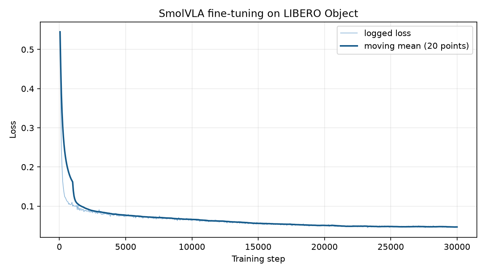

# SmolVLA в LIBERO и ROS2

Рабочий проект для тестового задания SmolVLA + LeRobot + ROS2.
Ноутбук используется для VS Code. На ПК-1 работают Docker, LIBERO и ROS2;
H100 предназначен прежде всего для обучения.

Реализованы воспроизводимое обучение и оценка на H100, BF16/INT8 benchmarks,
два ROS2-узла с неблокирующим инференсом и Compose runtime для замкнутого
эпизода LIBERO. Эталонный checkpoint уже проверен на 100 эпизодах: 87% success.
Сырые результаты хранятся в `artifacts/results`, актуальный ход финальной
матрицы — в [`docs/STATUS.md`](docs/STATUS.md).

## Документы и начало работы с Codex

- [`AGENTS.md`](AGENTS.md) — правила для агента, среды, ограничения и проверки.
- [`docs/TASK.md`](docs/TASK.md) — полный исходный текст задания и чек-лист приёмки.
- [`docs/STATUS.md`](docs/STATUS.md) — выполненная работа, доказательства и следующий этап.
- [`docs/REPORT.md`](docs/REPORT.md) — краткий отчёт о принятых решениях.
- Этот README — назначение проекта и команды запуска.
- [`docs/AUTONOMY.md`](docs/AUTONOMY.md) — управление экспериментами и план сдачи.
- [`docs/RUN_BUDGET.md`](docs/RUN_BUDGET.md) — бюджет, требующий согласования до обучения.
- [`docs/VSCODE_HANDOFF.md`](docs/VSCODE_HANDOFF.md) — передача единственного управляющего в IDE.

В Codex внутри VS Code можно начать сообщением:

> Прочитай AGENTS.md и указанные в нём документы. Проверь рабочую папку,
> состояние Git и путь к Python. Объясни, что уже готово, и предложи план
> следующего этапа из docs/STATUS.md. Пока не запускай обучение и не меняй среду.

Исходное задание сохранено в репозитории, поэтому доступ к DOCX в Downloads
на ноутбуке для продолжения работы не требуется.

Перенос Docker на D: описан в
[`setup/RECOVERY_2026-10-06.md`](setup/RECOVERY_2026-10-06.md).
Исправление HOME и запуска редактора от 12 октября — в
[`setup/CONNECTION_REPAIR_2026-10-12.md`](setup/CONNECTION_REPAIR_2026-10-12.md).

## Запуск на ПК-1

Запустить Docker Desktop на ПК-1, затем `setup/Open-PC1.cmd` на ноутбуке.
Для Codex подключите Happ **на ноутбуке** до открытия проекта. Launcher запускает
скрытый SSH-туннель к его HTTP-прокси и восстанавливает туннель после обрыва сети.
Ноутбук должен оставаться включённым, Happ — подключённым. Открытый ранее
проект можно продолжать использовать; после перезагрузки ноутбука снова откройте
его через launcher. Подробнее: [`setup/CODEX_NETWORK.md`](setup/CODEX_NETWORK.md).
Этот launcher запускает PowerShell-скрипт с разрешением только для своего процесса,
не меняя постоянную Execution Policy. Он открывает VS Code с отдельным
каталогом настроек `%LOCALAPPDATA%\SmolVLA-VSCode`, подключается к
`nlp-pc-2026` и сразу открывает Dev Container проекта, папку `/workspace`.
Перед запуском восстанавливает обязательный Docker-wrapper, сохраняя остальные
предпочтения и резервную копию изменяемого settings.json. Настройка wrapper
исключена из Settings Sync. Для открытия только WSL можно запустить
`Open-PC1.ps1` без параметра `-Container`.
Отдельные настройки нужны для Docker CLI проекта: этот параметр VS Code
имеет область application и игнорируется в workspace settings.
Обычные настройки редактора для учебных проектов сохраняются.

Следующие команды выполняются **в Ubuntu WSL на ПК-1**, из
`/home/alexander/projects/smolvla-sim`, вне контейнера:

```bash
cp -n .env.example .env
bash scripts/pc1.sh up -d dev
bash scripts/pc1.sh exec dev bash scripts/check.sh
```

Образ уже собран. `bash scripts/pc1.sh build` нужен после изменений Dockerfile;
перед пересборкой проверьте место на диске хранилища Docker Desktop и на C:.
Обычный запуск и Dev Containers используют только готовый образ: сборка вынесена
в `compose.build.yaml`, загрузка отсутствующего образа запрещена. Если образ
не найден, сначала проверьте Docker Engine; не запускайте сборку автоматически.
На ПК-1 используется Docker Desktop с WSL integration для Ubuntu. Перед работой
запустите Docker Desktop на ПК-1. Wrapper проверяет выбранный движок и не допускает
случайной работы с отдельным Docker Engine внутри Ubuntu.

После успешных проверок запустить один эпизод готовой модели:

```bash
bash scripts/pc1.sh exec dev bash scripts/eval_reference.sh
```

Это проверка окружения, а не измерение success rate: для отчёта требуются
все 10 задач и не менее 10 эпизодов на задачу, сравнение моделей и квантизации.
Обучение при настройке проекта автоматически не запускается.

В VS Code установить Dev Containers в удалённом контексте и выбрать
**Dev Containers: Reopen in Container**. Python контейнера: `/opt/venv/bin/python`.
Для терминала WSL с сохранением процесса: `bash scripts/open_tmux.sh`.
Отсоединение от tmux: Ctrl+B, затем D. Для длительных команд можно запускать
`bash scripts/pc1.sh exec -T dev ...` из tmux.

**В терминале VS Code внутри контейнера** команды выполняются напрямую:

```bash
cd /workspace
python -m pytest -q
ruff check .
```

Python уже установлен в `/opt/venv/bin/python`, активировать ещё одну venv не нужно.
Полная проверка среды: `bash scripts/check.sh`; отдельно ROS-инфраструктура:
`bash scripts/check_ros_package.sh`; один reference-эпизод:
`bash scripts/eval_reference.sh` (может скачивать веса).
Wrapper `scripts/pc1.sh` предназначен для WSL хоста, не для вложенного запуска
Docker из контейнера. Код меняется без пересборки образа.

`/workspace` подключён к исходникам WSL, `/data` — к данным на D:.
Домашняя папка `/data/home` отдельно смонтирована из постоянного Linux-тома
`smolvla-sim-home` внутри Docker Desktop на D:. Там находятся VS Code Server,
расширения и история Codex; Windows-папка `D:\Robotics\smolvla-sim\home`
сохранена как резервная копия состояния до переноса и больше не является
рабочим HOME. Том объявлен external: обычный `compose down -v` его не удаляет.
Не удаляйте `smolvla-sim-home` вручную. Он уже подготовлен на ПК-1; на новой
машине до первого запуска нужно создать том и обеспечить владельца UID/GID 1000
для его корня. Это часть подготовки среды, не ежедневного запуска.
Код, данные и домашняя папка сохраняются при пересоздании контейнера. Закрытие VS Code не
останавливает контейнер (`shutdownAction: none`); для длительных вычислений
используйте tmux и сохраняйте логи отдельно.

Проект использует отдельный Docker CLI config в `.runtime/docker-cli`, чтобы
не зависеть от старого credential helper Docker Desktop. Команды проекта
запускаются через `scripts/pc1.sh`. Параметр `GALLIUM_DRIVER=d3d12` применяется
только в WSL override; обычный Linux использует `compose.yaml` без override.

## Данные и воспроизводимость

Код ПК-1: `/home/alexander/projects/smolvla-sim`.
Веса, HF cache, видео и результаты: `/mnt/d/Robotics/smolvla-sim`, смонтирован
в контейнер как `/data`. Веса и датасеты не входят в Git или Docker-образ.
Дампы/кэш, перенесённые для освобождения C:, находятся отдельно в
`D:\Archives\robotics-setup-20261002`.

LeRobot закреплён на коммите `8fff0fde7c79f23a93d845d1a50e985de01f8b8a`
(v0.4.4). Все Python-зависимости перечислены в `requirements.lock`;
`requirements.ros.txt` закрепляет совместимую с colcon версию setuptools в ROS-образе.
Ревизии моделей и датасета указаны в `configs/artifacts.json`.
Версии ОС внутри образа сохраняются в `/opt/os-packages.txt`.
Для обновления зависимостей сначала меняются `.in`, затем пересоздаются lock
и повторяются проверки; существующие учебные окружения не используются.

## H100

Подключение с ноутбука: `setup/Open-H100.ps1`. Оно проходит через ПК-1 и его
Windows OpenSSH: приватный ключ остаётся на ПК-1. Прямой Linux SSH на ПК-1
может не работать из-за различий сетевого маршрута.

Единственный разрешённый корень работы:
`/home/jovyan/shares/SR006.nfs2/spiridonov/malnev_world_model`.
Каталог этого проекта внутри него: `smolvla-sim`.

```bash
cd /home/jovyan/shares/SR006.nfs2/spiridonov/malnev_world_model/smolvla-sim
.venv/bin/python scripts/h100_run.py --mode smoke -- .venv/bin/python scripts/h100_cuda_check.py
```

Для восстановления окружения есть `bash scripts/bootstrap_h100.sh`;
на подготовленном сервере повторять его при каждом подключении не нужно.
Команды H100 выполняются в
терминале сервера, не в контейнере ПК-1. Из WSL ПК-1 вход также доступен через
`bash scripts/h100_ssh.sh --interactive`.

Профиль H100 использует отдельный lock с CUDA 12.6 для проверенного драйвера
560.35.03; ПК-1 использует CUDA 12.8 для Blackwell. Python и код одинаковые.
GPU 0 запрещена. Управляемые задания выбирают свободную GPU 1–7 и держат
отдельный lease; одновременно допускаются не более трёх заданий. Занятая карта
не используется даже при явном `--gpu`.
Проверка свободной памяти не резервирует GPU для других пользователей сервера;
для длительных запусков нужно учитывать совместное использование ресурса.
Кэши, временные файлы и результаты H100 хранятся внутри `.runtime` проекта.

## Разработка

Исходный код: `src/smolvla_service`; ROS2-пакет: `ros2_ws/src/vla_bridge`.
CPU-проверки: `pytest -q` и `ruff check .`. Workflow GitHub Actions подготовлен,
но сам факт наличия файла не означает, что удалённый CI уже запускался.

На ноутбуке код лежит в `C:\Users\malne\Projects\smolvla-sim`, вне OneDrive.
После коммита `setup/Sync-PC1.ps1` отправляет изменения на ПК-1;
`setup/Sync-PC1.ps1 -Pull` забирает сделанные там коммиты. Используется собственный
bare Git-репозиторий на ПК-1; публичный репозиторий пока не создавался.
Перед сменой машины завершайте и коммитьте изменения. Синхронизация H100:
`bash scripts/sync_h100.sh` на ПК-1, только из чистого Git-дерева.

## Экспериментальный протокол

Конфиг [`configs/train_libero_object.json`](configs/train_libero_object.json)
использует 454 эпизода `libero_object`, seed 42, batch size 16, 30 000 шагов и
AdamW с learning rate 1e-4. Обучаются action expert и проекции состояния,
действия и времени; VLM и vision encoder заморожены. Такой выбор сохраняет
универсальные визуально-языковые признаки и направляет ограниченный бюджет на
новое пространство состояний и действий LIBERO. Используются глобальные
mean/std закреплённого датасета, камеры переименовываются явным `rename_map`.

Основной запуск завершил 30 000 шагов за 2 ч 59 мин на одной H100. Loss снизился
с 0.545 на шаге 50 до 0.047; повторная загрузка итогового checkpoint и настоящий
BF16 forward прошли успешно. CSV, summary и данные проверки checkpoint находятся
в [`artifacts/results/training`](artifacts/results/training).



Финальный протокол закреплён в
[`configs/evaluation_protocol.json`](configs/evaluation_protocol.json): задачи
0–9, по 10 эпизодов, seed 10000+, одинаковые начальные состояния для пяти
вариантов. В него входят reference BF16 n=10, своя BF16 с n=1/10/50 и своя INT8
n=10. Сырые outcomes проходят независимую проверку количества задач, эпизодов и
агрегированной success rate.

## Результаты оценки

Все значения ниже получены локальными запусками на закреплённых версиях кода и
весов; это не цифры из статьи. Во всех строках использованы одни задачи, seed
10000+ и по 10 эпизодов на каждую из 10 задач. Проверенный агрегат и сырые
outcomes находятся в [`artifacts/results/summary`](artifacts/results/summary).

| Вариант | Precision | n_action_steps | Success | Среднее время эпизода |
|---|---:|---:|---:|---:|
| `HuggingFaceVLA/smolvla_libero` | BF16 | 10 | 87/100 (87%) | 29.03 с |
| собственная модель | BF16 | 1 | 85/100 (85%) | 51.95 с |
| собственная модель | BF16 | 10 | **97/100 (97%)** | **23.54 с** |
| собственная модель | BF16 | 50 | 71/100 (71%) | 24.71 с |
| собственная модель | INT8 | 10 | 0/100 (0%) | 41.54 с |

`n_action_steps=10` оказался лучшим компромиссом. При `n=1` политика чаще
пересчитывает действие и эпизод занимает в 2.2 раза больше времени. При `n=50`
она долго выполняет устаревший план и теряет 26 процентных пунктов success rate.

## Квантизация и latency

Latency измерена для одного вызова после warmup. Каждый CUDA sample окружён
`torch.cuda.synchronize()`. Размер — сериализованные веса, peak CUDA — максимум,
зафиксированный PyTorch во время benchmark. Полные отчёты находятся в
[`artifacts/results/bench-bf16-cuda`](artifacts/results/bench-bf16-cuda),
[`bench-int8-cuda`](artifacts/results/bench-int8-cuda) и
[`bench-bf16-cpu`](artifacts/results/bench-bf16-cpu).

| Вариант | Устройство | p50 | p95 | Размер | Peak CUDA | Success, n=10 |
|---|---|---:|---:|---:|---:|---:|
| BF16 | H100 GPU | **155.83 мс** | **156.90 мс** | 906.7 МБ | 993.3 МБ | **97/100** |
| INT8 `Linear8bitLt` | H100 GPU | 363.40 мс | 364.98 мс | **548.2 МБ** | **651.2 МБ** | 0/100 |
| BF16 | CPU сервера | 2998.81 мс | 3047.31 мс | 906.7 МБ | — | 97/100¹ |

¹ Success взят из BF16 GPU rollout: precision и checkpoint те же; CPU-строка
измеряет только latency. Использованный bitsandbytes INT8 backend требует CUDA,
поэтому CPU latency для него неприменима.

INT8 уменьшил файл на 39.5% и peak memory на 34.4%, но стал в 2.3 раза медленнее
BF16 на H100 и провалил все 100 эпизодов. Для Jetson Orin 16 ГБ я выбрал бы
BF16, `n_action_steps=10`: измеренный peak меньше 1 ГБ, а success максимален.
Перед продуктовым развёртыванием стоит отдельно проверить FP16/TensorRT на самом
Orin; текущую INT8-схему использовать нельзя без calibration-aware квантизации и
повторной closed-loop оценки.

## Видео и ROS2

Репрезентативные записи:

- [готовая модель, успешный эпизод](artifacts/videos/reference-bf16-n10-success-task0-episode0.mp4);
- [собственная BF16 n=10, успешный эпизод](artifacts/videos/own-bf16-n10-success-task0-episode0.mp4);
- [собственная BF16 n=10, неудачный эпизод](artifacts/videos/own-bf16-n10-failure-task2-episode7.mp4).

Финальный ROS2 closed loop выполнен на RTX 5070 Ti: два узла обменивались двумя
изображениями, состоянием и семимерным действием, после 149 действий симулятор
записал `ROS2_EPISODE_RESULT success=True`. Состояние managed job и полный лог
сохранены в [`artifacts/results/ros2-own-final`](artifacts/results/ros2-own-final).

Для итогового запуска на ПК-1 checkpoint должен находиться в
`/data/models/own-final`. Команда ниже запускает оба ROS2-узла и один эпизод;
обычный `up` также оставляет активным сервис редактора `dev`:

```bash
bash scripts/pc1.sh up runtime
```

Для разработки без эпизода используйте `bash scripts/pc1.sh up -d dev`.
Веса монтируются из D: и не входят в Git или образ.

## Ограничения и что дальше

Оценка покрывает только десять задач `libero_object` и 100 фиксированных
начальных состояний на вариант. H100 latency нельзя переносить на Orin без
замера на целевом устройстве; CPU benchmark также относится к CPU сервера.
MuJoCo не моделирует все эффекты камер, приводов и контакта реального SO-101.
Для sim-to-real нужны реальные демонстрации, калибровка камер и кинематики,
ограничения скорости и усилия, safety layer и постепенная hardware-валидация.

Первоначальные проверки: `setup/VALIDATION.md`. Актуальные проверки Docker
Desktop и инструкции восстановления: `setup/RECOVERY_2026-10-06.md`.
