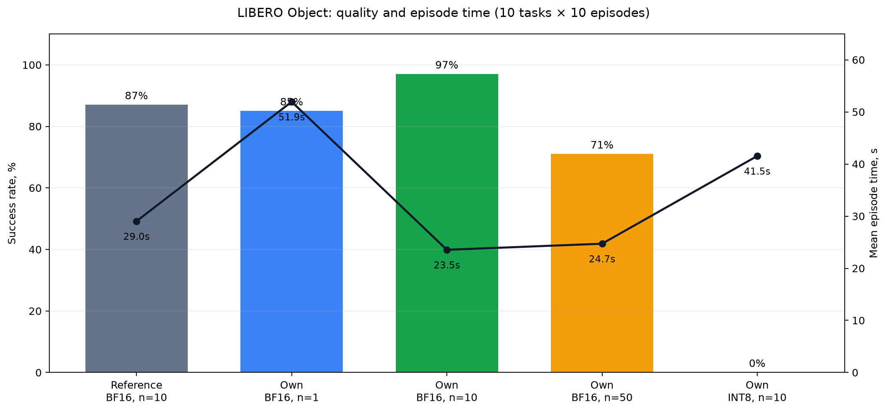

# SmolVLA + LeRobot + ROS2 в LIBERO

[](https://github.com/dezertod11/smolvla-sim/actions/workflows/ci.yml)

Проект реализует полный цикл тестового задания: дообучение SmolVLA на
`libero_object`, сравнение с готовой моделью, исследование `n_action_steps`,
BF16/INT8 benchmarks и замкнутый ROS2-контур в симуляторе LIBERO.

Собственная BF16-модель получила **97/100 успешных эпизодов** против 87/100 у
`HuggingFaceVLA/smolvla_libero`. Docker, MuJoCo EGL, LIBERO и ROS2 closed loop
проверены на **NVIDIA GeForce RTX 5070 Ti**. Веса модели находятся во внешнем
хранилище и не включены в Git или Docker image.

## Быстрый запуск

Требования:

- Windows с Ubuntu WSL2 и Docker Desktop с включённой WSL integration;
- актуальный NVIDIA-драйвер с поддержкой CUDA для RTX 5070 Ti;
- Git, Docker Compose v2 и не менее 25 ГБ свободного места.

Чистая установка и запуск одного замкнутого эпизода выполняются четырьмя
командами:

```bash
git clone https://github.com/dezertod11/smolvla-sim.git && cd smolvla-sim
bash scripts/bootstrap_pc1.sh
bash scripts/download_own_checkpoint.sh
bash scripts/pc1.sh up runtime
```

Bootstrap создаёт внешний Docker volume и собирает закреплённый образ. Скрипт
загрузки получает [собственный checkpoint](https://github.com/dezertod11/smolvla-sim/releases/tag/smolvla-libero-object-v1)
и проверяет каждый файл по SHA256. Последняя команда запускает `sim_node` и
`smolvla_node`; процесс завершается после результата эпизода.

Для повторного запуска достаточно:

```bash
bash scripts/pc1.sh up runtime
```

## Проверки

CPU-тесты и статический анализ выполняются внутри контейнера:

```bash
bash scripts/pc1.sh up -d dev
bash scripts/pc1.sh exec -T dev bash scripts/check.sh
```

Проверка включает Ruff и 50 тестов pytest. Тесты не требуют GPU, весов или
запущенного ROS graph. Они покрывают:

- RGB HWC `uint8` → нормализованный CHW tensor;
- семимерное действие → ROS-совместимое сообщение;
- загрузку и валидацию YAML-параметров;
- асинхронный single-flight inference;
- обработку некорректных данных;
- расчёт метрик и INT8-конвертацию с mock-моделью.

Тот же CPU-набор запускается в
[GitHub Actions](https://github.com/dezertod11/smolvla-sim/actions/workflows/ci.yml).

## Структура

```text
configs/                         конфигурации обучения и оценки
docker/                          образ ROS2 Jazzy + LeRobot + CUDA
ros2_ws/src/vla_bridge/          ROS2-пакет, launch и YAML
src/smolvla_service/             inference, преобразования и квантизация
scripts/                         bootstrap, обучение, оценка и benchmarks
tests/                           CPU unit-тесты
artifacts/results/               loss, outcomes, latency и ROS2-логи
artifacts/videos/                записи успешных и неуспешных эпизодов
docs/REPORT.md                   краткий отчёт
docs/TASK.md                     исходные требования
```

LeRobot закреплён на коммите
`8fff0fde7c79f23a93d845d1a50e985de01f8b8a` (`v0.4.4`). Python-зависимости
закреплены в `requirements.lock`, ROS2-зависимости — в
`requirements.ros.txt`, ревизии моделей и датасета — в
`configs/artifacts.json`. Используются ROS2 Jazzy, Ubuntu 24.04, Python 3.12,
MuJoCo EGL и LIBERO.

## Обучение

Конфигурация [`configs/train_libero_object.json`](configs/train_libero_object.json)
использует 454 демонстрации `libero_object` — 66 984 кадра для десяти задач.
Камеры и состояния согласованы с моделью через явный `rename_map`.

Основные параметры:

| Параметр | Значение |
|---|---:|
| Seed | 42 |
| Batch size | 16 |
| Шаги | 30 000 |
| Optimizer | AdamW |
| Learning rate | `1e-4` |
| Warmup | 1 000 шагов |
| Precision | BF16 AMP |
| `chunk_size` | 50 |
| `n_action_steps` при основной оценке | 10 |

VLM и vision encoder заморожены. Обучаются action expert и проекции состояния,
действия и времени: **99 880 992** из 450 046 176 параметров. Это сохраняет
предобученные визуально-языковые признаки и направляет обучение на управление
манипулятором.

Запуск завершил 30 000 шагов за 2 ч 59 мин. Loss снизился с 0,545 на шаге 50
до 0,047; минимальное значение — 0,045. Итоговый checkpoint повторно загружен
и проверен настоящим BF16 forward. Метрики записывались в W&B offline и
экспортированы в воспроизводимые CSV/PNG/JSON. Артефакты:

- [`loss.csv`](artifacts/results/training/loss.csv);
- [`loss.png`](artifacts/results/training/loss.png);
- [`training_summary.json`](artifacts/results/training/training_summary.json);
- [`checkpoint_validation.json`](artifacts/results/training/checkpoint_validation.json).


## Протокол оценки

Все варианты используют одинаковые задачи 0–9, по десять эпизодов на задачу и
одинаковые начальные состояния с seed 10000+. Протокол закреплён в
[`configs/evaluation_protocol.json`](configs/evaluation_protocol.json).

| Вариант | Precision | `n_action_steps` | Success | Среднее время эпизода |
|---|---:|---:|---:|---:|
| `HuggingFaceVLA/smolvla_libero` | BF16 | 10 | 87/100 (87%) | 29,03 с |
| собственная модель | BF16 | 1 | 85/100 (85%) | 51,95 с |
| собственная модель | BF16 | 10 | **97/100 (97%)** | **23,54 с** |
| собственная модель | BF16 | 50 | 71/100 (71%) | 24,71 с |
| собственная модель | INT8 | 10 | 0/100 (0%) | 41,54 с |

`n_action_steps=10` дал лучший компромисс. При `n=1` политика чаще выполняет
inference, поэтому эпизод длится в 2,2 раза дольше. При `n=50` политика дольше
исполняет устаревший план и теряет 26 процентных пунктов success rate.

Сырые результаты и проверенный агрегат находятся в
[`artifacts/results/summary`](artifacts/results/summary).



## Квантизация и latency

INT8 реализован заменой крупных `Linear` на `bitsandbytes.Linear8bitLt`.
Маленькие слои и `lm_head` исключаются и перечисляются в отчёте. Перед замерами
выполняется warm-up; каждый CUDA sample ограничен
`torch.cuda.synchronize()`. Таблица содержит реальные p50/p95, размер
сериализованных весов и peak memory PyTorch.

| Вариант | Устройство | p50 | p95 | Размер | Peak CUDA | Success, n=10 |
|---|---|---:|---:|---:|---:|---:|
| BF16 | CUDA GPU | **155,83 мс** | **156,90 мс** | 906,7 МБ | 993,3 МБ | **97/100** |
| INT8 `Linear8bitLt` | CUDA GPU | 363,40 мс | 364,98 мс | **548,2 МБ** | **651,2 МБ** | 0/100 |
| BF16 | CPU | 2998,81 мс | 3047,31 мс | 906,7 МБ | — | 97/100¹ |

¹ Для CPU приведена только latency; success относится к той же BF16-модели в
GPU rollout. Использованный INT8 backend требует CUDA.

INT8 уменьшил размер на 39,5% и peak memory на 34,4%, но оказался в 2,3 раза
медленнее BF16 и получил 0/100. Для Jetson Orin 16 ГБ рекомендуется BF16 с
`n_action_steps=10`. Перед эксплуатацией на Orin необходимо отдельно измерить
FP16/TensorRT на самом устройстве; текущую INT8-схему использовать нельзя без
calibration-aware квантизации и повторной closed-loop оценки.

## ROS2

Пакет `vla_bridge` содержит два узла:

- `sim_node` публикует `/camera/image_raw`, `/camera/wrist/image_raw` и
  `/robot_state`, принимает `/vla/action` и делает шаг LIBERO;
- `smolvla_node` собирает согласованный snapshot, выполняет inference в отдельном
  single-flight worker и публикует семимерное действие.

Executor продолжает принимать сообщения во время inference. Если камеры или
состояние отсутствуют либо устарели, watchdog пишет предупреждение и ждёт новые
данные. Путь checkpoint, инструкция, устройство, `bf16`/`int8`,
`n_action_steps`, частота и timeout задаются в
[`libero_object_own_final.yaml`](ros2_ws/src/vla_bridge/config/libero_object_own_final.yaml).

Один launch-файл поднимает оба узла. Финальный closed loop на **RTX 5070 Ti**
успешно завершил эпизод; точный Compose-запуск вернул код 0 и результат
`success=True` после 159 действий. Transcript, timing, checksum и метаданные
находятся в
[`artifacts/results/ros2-own-final`](artifacts/results/ros2-own-final).

### Интерактивное окно

Диагностический интерфейс с двумя камерами, ручным управлением и запуском
локального или Hugging Face checkpoint поднимается отдельно:

```bash
bash scripts/pc1.sh up teleop
```

После запуска интерфейс доступен на `http://localhost:8890`. Внешний порт можно
изменить переменной `TELEOP_PORT` в `.env`. Инструкция модели
жёстко связана с `task_id` текущей сцены, поэтому окно не позволяет случайно
запустить политику для другого объекта. При старте и сбросе очищаются оставшиеся
действия предыдущего чанка; камеры и состояние передаются модели только как один
согласованный snapshot. Окно показывает success rate завершённых эпизодов
текущей сессии.

Интерактивный режим предназначен для диагностики одного сценария. Итоговые
значения success rate в таблицах получены отдельным воспроизводимым протоколом
из `configs/evaluation_protocol.json` на 100 эпизодах для каждого варианта.

## Видео

- [готовая модель, успешный эпизод](artifacts/videos/reference-bf16-n10-success-task0-episode0.mp4);
- [собственная BF16, успешный эпизод](artifacts/videos/own-bf16-n10-success-task0-episode0.mp4);
- [собственная BF16, неуспешный эпизод](artifacts/videos/own-bf16-n10-failure-task2-episode7.mp4);
- [полный запуск Docker Compose, ускоренная запись 1 мин 54 с](artifacts/videos/docker-compose-up.mp4).

## Ограничения

Оценка охватывает только десять задач `libero_object` и 100 фиксированных
начальных состояний на вариант. Измерения CUDA GPU и CPU нельзя переносить на
Jetson Orin без проверки на целевом устройстве. MuJoCo не моделирует все эффекты
камер, приводов и контакта реального SO-101. Для sim-to-real нужны реальные
демонстрации, калибровка камер и кинематики, ограничения скорости и усилия,
safety layer и постепенная аппаратная валидация.

Краткое обоснование решений приведено в [`docs/REPORT.md`](docs/REPORT.md) и
[одностраничном PDF](output/pdf/smolvla_report.pdf). Полная сверка требований с
доказательствами находится в [`docs/ACCEPTANCE.md`](docs/ACCEPTANCE.md).
